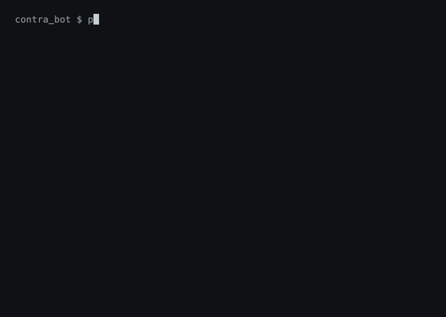

# Contra

If r/wallstreetbets is buying, Contra wants to sell.



<sub>`python demo.py`: the real filters and the real flip on five sample posts. No keys needed.</sub>

Contra reads new posts on a subreddit, asks Claude what the author is actually doing (ticker, long or short, how sure), flips it, and is meant to place the opposite trade on Alpaca's paper account. Every post, filter decision, signal and order lands in SQLite so you can check its working afterwards.

It's an experiment in whether the internet is a reliable contrarian indicator. Fake money only, and that's staying the case. It's also unfinished: see [where it's at](#where-its-at) before you trust it with even fake money.

## What it does to a post

1. **Polls** the subreddits in `config.yaml`. Posts only, never comments.
2. **Bins the noise** before spending a token: sports bets and parlays, image-only memes, posts with no ticker or coin in them, and authors under 100 karma.
3. **Asks Claude** to turn what's left into a signal: ticker, asset type, direction, confidence.
4. **Flips it** when `mode: against`. Long becomes short. Set `mode: with` to follow the crowd instead, if you're feeling brave.
5. **Places the paper order** if confidence clears 0.7 and fewer than ten positions are open, sized to about $500 (never less than one share). Positions are closed after seven days.
6. **Writes it all down.** Posts, filter results, signals and trades, one SQLite file.

Each run opens with a dashboard of open positions and profit and loss.

## Try it without keys

```sh
git clone https://github.com/fergo5002/contraTradingBot.git
cd contraTradingBot/contra_bot
pip install -r requirements.txt
python demo.py
```

The demo runs the real filter and inversion code on sample posts. The one thing it fakes is Claude's reading of each post, which is written out in `demo.py` so you can see the shape the bot expects back.

## Run it for real (on paper)

You need three sets of keys:

- **Reddit:** make a "script" app at [reddit.com/prefs/apps](https://www.reddit.com/prefs/apps) and copy the client ID and secret.
- **Anthropic:** an API key from [console.anthropic.com](https://console.anthropic.com).
- **Alpaca:** paper trading keys from the paper dashboard at [alpaca.markets](https://alpaca.markets).

```sh
cp .env.example .env    # fill in the keys
python main.py
```

Everything else lives in `config.yaml`:

```yaml
subreddits:
  - wallstreetbets
mode: against            # or "with"
markets_enabled:
  - stocks
  - crypto
min_confidence: 0.7
max_position_size_usd: 500
max_open_positions: 10
holding_period_days: 7
min_author_karma: 100
```

Add more subreddits to the list and each is polled on its own. The same ticker won't be traded twice at once.

Alpaca won't short crypto, so in `against` mode a bullish crypto post is skipped rather than sold. Options are off by default.

## Where it's at

Unfinished, and honest about it. Reading the code turns up three bugs that stop it doing what this page describes:

- **It never places an order.** `signal_parser.py` saves each signal before returning it, and the 24-hour duplicate check in `position_manager.py` then finds that same signal and skips the trade. Every time.
- **Options would be flipped twice.** The signal goes from call to put *and* from long to short, so the bot would sell a put, which is a bet in the same direction as the crowd.
- **Crypto tickers get mangled on the way back.** Trades are stored as `ETH/USD`, and closing or pricing them turns that into `ETH/USD/USD`, so crypto positions wouldn't close or de-duplicate.

The demo above doesn't touch any of those paths, which is why it works.

## Inside

| File | Job |
|---|---|
| `main.py` | the loop and the dashboard |
| `reddit_monitor.py` | fetching posts with PRAW |
| `filters.py` | the free, no-API checks |
| `signal_parser.py` | the Claude call and the flip |
| `position_manager.py` | limits, duplicates, closing stale positions |
| `trade_executor.py` | Alpaca orders |
| `db.py` | the SQLite audit trail |

Python 3.10 or newer. MIT licensed.

Not financial advice. If it were good financial advice, it wouldn't be on GitHub.
